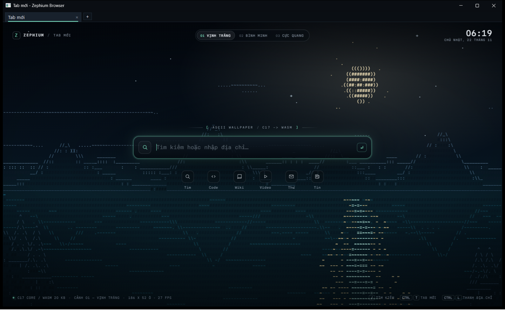
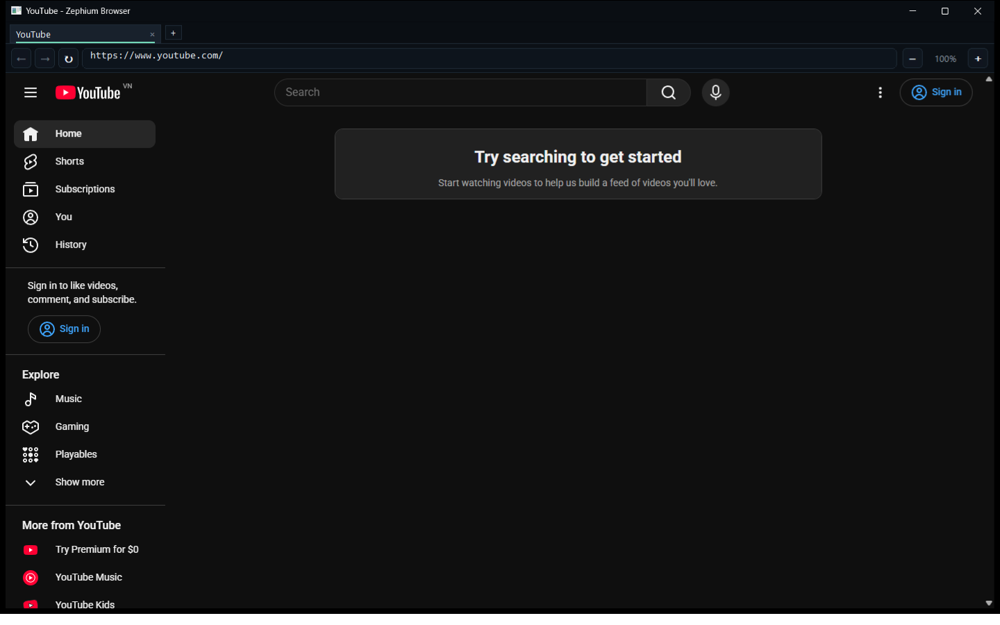

# Zephium Browser (C17 engine + WSL WebKitGTK shell + Windows WebView2 shell)

Bản port hoàn chỉnh sang ngôn ngữ **C (chuẩn ISO C17)** của **Zephium Browser**, loại bỏ các thành phần "work" / agentic thừa, giữ lại toàn bộ tính năng duyệt web cốt lõi với độ chính xác bit-for-bit so với bản gốc Rust.

---

## 0. Chạy nhanh (Quick start)

Có **2 shell** dùng chung core C17 — chọn theo môi trường:

| | Windows (native) | WSL (WebKitGTK) |
|---|---|---|
| Engine | WebView2 / Edge Chromium | WebKitGTK 4.1 |
| File chạy | `windows\zephium_win.exe` | `build/zephium` (qua `run_wsl.sh`) |
| Đồ họa | GPU (D3D12), mượt | llvmpipe (CPU) nếu WSL không có `/dev/dri` |
| Tab | Multi-tab + tab ngủ đông | Multi-tab |
| Dùng khi | Dùng hằng ngày trên Windows | Test hành vi engine WebKit / môi trường Linux |

### Windows (native, khuyến nghị)

Yêu cầu: Windows 10/11 x64 + **Microsoft Edge WebView2 Runtime** (Windows 11 có sẵn;
máy thiếu thì tải ở https://developer.microsoft.com/microsoft-edge/webview2/).
Kiểm tra nhanh:

```powershell
reg query "HKLM\SOFTWARE\WOW6432Node\Microsoft\EdgeUpdate\Clients\{F3017226-FE2A-4295-8BDF-00C3A9A7E4C5}" /v pv
```

```powershell
cd C:\path\to\zephium-c\windows

.\zephium_win.exe                                      # mở tab mới (ASCII start page)
.\zephium_win.exe https://grokipedia.com               # mở URL
.\zephium_win.exe --tab-sleep 10 https://youtube.com   # tab ngủ đông sau 10 phút
.\zephium_win.exe --tab-sleep 0 https://example.com    # tắt ngủ đông
```

- `WebView2Loader.dll` phải nằm cạnh exe; lấy `zephium_win.exe` + `WebView2Loader.dll`
  từ mục **Releases** của repo (xem *Binaries* trong §4), hoặc tự build từ source.
- Exe chưa ký số → SmartScreen có thể hỏi: *More info → Run anyway*.
- Phím tắt: `Ctrl+T` tab mới · `Ctrl+W` đóng tab · `Ctrl+Tab`/`Ctrl+Shift+Tab` chuyển tab ·
  `Ctrl+L` focus ô địa chỉ · `F5` tải lại · `Ctrl++`/`Ctrl+-` zoom.
- Log chẩn đoán: `windows\zephium_win.log` (dòng `tab N hibernated`, `tab N waking`, `navigate …`).
- Chặn quảng cáo chạy **ở tầng mạng** (không extension): engine
  [adblock-rust](https://github.com/brave/adblock-rust) kiểm tra từng request trong
  `WebResourceRequested`. Bộ lọc (EasyList/EasyPrivacy/uBO) tải về lần đầu rồi cập nhật
  mỗi 24h; cache engine nhị phân cho khởi động nóng ~8ms. Tắt bằng `--no-adblock` hoặc
  `$env:ZEPHIUM_ADBLOCK='0'`. Chi tiết: [docs/ADBLOCK.md](docs/ADBLOCK.md).
- Build lại từ source:
  ```powershell
  cd C:\path\to\zephium-c\windows
  powershell -ExecutionPolicy Bypass -File fetch_sdk.ps1   # tải WebView2 SDK (lần đầu)
  powershell -ExecutionPolicy Bypass -File fetch_rust.ps1   # Rust (GNU) cho engine adblock (lần đầu)
  mingw32-make                                             # build staticlib + exe + copy newtab/
  ```
  Engine adblock là Rust: máy cần Rust `stable-x86_64-pc-windows-gnu` (script trên cài
  giúp). `mingw32-make adblock-test` chạy unit test + benchmark của engine.

### Màn hình tab mới (ASCII start page)



Cùng bộ chrome tối khi đang duyệt một trang thật (YouTube):



`Ctrl+T` — và lần khởi động không truyền URL — mở một start page full-bleed:
hình nền ASCII động, omnibox ở giữa màn hình, 6 shortcut, đồng hồ và 3 cảnh
(Vịnh trăng / Bình minh / Cực quang).

- **Core là C17**: toàn bộ địa hình, mặt nước, sao, mặt trăng và cực quang được
  sinh trong `newtab/ascii_core.c`, biên dịch freestanding sang WebAssembly
  (`newtab/ascii_core.wasm`, ~20 KB, không import). JavaScript chỉ đọc buffer
  `uint16_t` và vẽ glyph màu lên canvas.
- **Dựa trên bộ ascii.rest**: dùng font Paper Mono và ngôn ngữ hình ảnh ASCII của
  file zip; các đỉnh núi được "vẽ" thủ công (vị trí/độ cao/độ dốc), không phải
  noise ngẫu nhiên.
- **Tích hợp shell**: WebView2 map host `newtab.zephium` vào thư mục
  `newtab/`; khi start page active, hàng toolbar Win32 được ẩn để nội dung
  full-bleed. Chrome mặc định dùng tông tối với accent mint, kể cả khi tab đang
  mở YouTube hay một trang sáng; nút tròn ngay trái cụm zoom chuyển sang giao
  diện **Frutiger Aero** (tab pill, nút tròn, gradient xanh) và lưu lựa chọn vào
  `%LOCALAPPDATA%\Zephium\theme.txt`. Các nút back/forward/reload/zoom và ô địa
  chỉ được owner-draw để không còn mảng trắng Win32 cũ. Omnibox gửi
  `navigate|<input>` về shell, shell phân loại URL/search bằng core C17
  `navigation` rồi điều hướng tab.
- **Build core**:
  ```powershell
  powershell -ExecutionPolicy Bypass -File newtab\build.ps1
  ```
  Cần clang có target `wasm32`, Node và gcc; không cần npm. Chi tiết:
  [`newtab/README.md`](newtab/README.md).
- Nếu `zephium_win.exe` đang chạy, Windows khoá file exe: đóng cửa sổ đó rồi
  `mingw32-make` lại (không còn bản binary "dùng ngay" nào trong repo — xem
  *Binaries* trong §4).

### WSL (WebKitGTK)

```bash
cd /mnt/c/path/to/zephium-c
chmod +x setup_wsl.sh run_wsl.sh
./setup_wsl.sh                        # 1 lần: WebKitGTK, GStreamer, fonts
./run_wsl.sh https://duckduckgo.com   # tự build bằng CMake rồi chạy
```

Các cờ hữu ích:

| Cờ | Ý nghĩa |
|---|---|
| `--x11` / `--wayland` | ép backend hiển thị (mặc định `x11` trên WSLg) |
| `--disable-gpu` | chỉ dùng GL phần mềm (llvmpipe) |
| `--screenshot <file> --screenshot-delay N` | chụp ảnh trang đang render rồi thoát |
| `--headless` | REPL/CLI khi không có màn hình |
| `--no-adblock` | tắt bộ lọc quảng cáo cho phiên chạy này |
| `--adblock-status` | in trạng thái cache bộ lọc (version, rule, warm/cold) rồi thoát |

**Ad blocking**: **bật mặc định**, chặn ở tầng mạng bằng content blocker của WebKit
(chứ không phải extension). Bộ lọc là bản EasyList/EasyPrivacy/uBO đã chuyển đổi sang JSON
lấy từ release [bnema/ublock-webkit-filters](https://github.com/bnema/ublock-webkit-filters)
(**2 combined part = 246.880 rule**), tải về background rồi biên dịch bằng
`WebKitUserContentFilterStore` và gắn vào user-content-manager của **mọi tab**:

- lần chạy **đầu tiên**: 4 rule built-in của module C17 `blocker` chặn tạm trong lúc tải
  ~40 MB JSON + biên dịch (~10–20 giây ở background, không chặn duyệt web); log
  `[ADBLOCK] ... compile_ms=...`;
- các lần sau: filter đã biên dịch được WebKit **load từ store** (~0.5 ms/filter, log
  `cache hit ... (warm start)`), và version được kiểm tra lại sau khi cửa sổ hiện 3 giây
  rồi mỗi **24h** — có bản mới thì tải/biên dịch/gắn lại rồi xoá filter cũ;
- mọi lỗi (mạng, JSON hỏng, filter > 150k rule) → `[WARN] [ADBLOCK_FAILED] ...` và
  **giữ bộ lọc đang dùng**, browsing không bị ảnh hưởng.

`--adblock-status` in ra version/rule/cache hiện tại rồi thoát (exit 0 nếu cache dùng
được, 2 nếu chưa). Cache nằm ở `$XDG_CACHE_HOME/zephium/adblock` (filter đã biên dịch
trong `.../zephium/content-filters`); đổi bằng `ZEPHIUM_ADBLOCK_DIR`. Máy ít RAM có thể
dùng `ZEPHIUM_ADBLOCK_MODE=lists` (4 list riêng, 243.989 rule, store ~81 MB thay vì
~105 MB). Nếu thiếu `libsoup-3.0-dev` thì shell vẫn build/chạy nhưng không tự cập nhật
danh sách. Tắt bằng cờ hoặc biến môi trường:

```bash
ZEPHIUM_ADBLOCK=0 ./run_wsl.sh https://duckduckgo.com
./run_wsl.sh --no-adblock https://duckduckgo.com
```

**Sandbox WebKit**: sandbox WebProcess (bubblewrap) **bật mặc định**, kể cả trên WSL.
Chỉ tắt khi kernel WSL2 không cấp được unprivileged user namespace (WebKit không khởi
động, log có lỗi `bwrap`):

```bash
ZEPHIUM_NO_SANDBOX=1 ./run_wsl.sh https://duckduckgo.com
```

Khi tắt, browser in cảnh báo `[WARN] [SANDBOX] WebKit sandbox DISABLED (...)` — trang web
chạy với toàn bộ quyền của user, nên chỉ dùng khi thật cần. `run_wsl.sh` không còn export
`WEBKIT_DISABLE_SANDBOX_THIS_IS_DANGEROUS`; `ZEPHIUM_NO_SANDBOX=1` là công tắc duy nhất.

**Popup, tải file, tìm trong trang**: `target="_blank"`/`window.open` mở thành **tab mới**
(URL vẫn phải qua allow-list như ô địa chỉ). File tải về nằm trong thư mục **Downloads** của
user với tên đã làm sạch (chỉ lấy phần cuối, bỏ dấu phân cách đường dẫn và dấu chấm ở đầu) và
được ghi vào bảng `downloads` (state 0 → 1). `Ctrl+F` mở thanh tìm trong trang: gõ để tìm,
`Enter`/`Shift+Enter` tiến/lùi, `Esc` đóng. Lỗi chứng chỉ TLS **chặn** trang và hiện trang
"Insecure connection blocked" — không có tuỳ chọn bỏ qua chứng chỉ.

Kiểm tra sau khi chạy: `python3 read_log.py` (các mục `[RENDER]`, `[MEDIA]`, `[PAGE]`).
Binary không đồ họa: `./build/zephium --batch` (regression), `./build/zephium --headless` (REPL).

### Nếu chạy không như mong đợi

| Hiện tượng | Xử lý |
|---|---|
| Windows báo thiếu WebView2 / cửa sổ trắng | Cài **Edge WebView2 Runtime** rồi chạy lại; xem `windows\zephium_win.log` |
| Windows: `WebView2Loader.dll is missing` | Copy DLL cạnh exe (hoặc `mingw32-make loader`) |
| WSL: cửa sổ trắng / site không hiện UI | `./run_wsl.sh --screenshot /tmp/page.png --screenshot-delay 20 <url>` rồi xem `python3 read_log.py` |
| WSL: video YouTube không phát | Không tắt compositing/DMABUF (bản này đã xử lý); xem mục *Sự cố đã biết* bên dưới |
| WSL chậm, tụt FPS | Kiểm tra `ls /dev/dri`: không có `renderD128` thì đang render bằng CPU — xem mục **Hiệu năng** |
| WSL: WebKit không khởi động, log có lỗi `bwrap` / sandbox | Kernel thiếu unprivileged user namespace: chạy `ZEPHIUM_NO_SANDBOX=1 ./run_wsl.sh <url>` (sandbox tắt, có cảnh báo `[SANDBOX]`) |
| Adblock không chặn (log có `[ADBLOCK_FAILED]`) | Xem thông báo lỗi ngay sau đó; tắt hẳn bằng `ZEPHIUM_ADBLOCK=0` nếu filter làm chậm trang |
| Windows: log ghi `adblock: engine unavailable` | Chưa tải được danh sách (mạng/proxy); kiểm tra `%LOCALAPPDATA%\Zephium\adblock\lists` |
| Windows: build lỗi thiếu `WaitOnAddress` khi link | Thiếu `-lsynchronization` trong `windows/Makefile` |
| GTK: cần xoá cache bộ lọc / tải lại từ đầu | Xoá `$XDG_CACHE_HOME/zephium/adblock` và `$XDG_CACHE_HOME/zephium/content-filters` rồi chạy lại (hoặc đặt `ZEPHIUM_ADBLOCK_DIR`) |
| GTK: lần đầu chậm / RAM tăng ~550 MB khi biên dịch | Bình thường: WebKit đang biên dịch 246.880 rule ở background; có thể dùng `ZEPHIUM_ADBLOCK_MODE=lists` để giảm |

---

## 1. Cấu trúc thư mục

```
zephium-c/
├── blocker/            # Ad blocking: C17 rules → WebKit content-filter JSON, bộ lọc tải về
│   │                   #   (filters.c = manifest/cache/JSON, portable, có unit test)
│   ├── adblock_ffi.h   #   C ABI của engine Rust cho shell Windows (đóng băng)
│   ├── filters.c/h     #   cache bộ lọc WebKit: manifest, staleness 24h, validate JSON
│   └── rust/           #   adblock-rust 0.13.6 → staticlib (Rust, MPL-2.0)
├── browser_core/       # Core browser state (Tabs, Omnibox, Zoom, SQLite store)
├── geometry/           # Point, Size, Rect tính toán giao diện
├── ids/                # 128-bit ULID Crockford-32 định danh Tabs/Windows
├── navigation/         # URL Classification, Search fallback, SSRF & Local host protection
├── store/              # SQLite3 WAL store (Bookmarks, History, Downloads, Preferences;
│                       #   API liệt kê/tìm kiếm + tiến độ tải, xem store/port.h)
├── zoom/               # Điều khiển zoom cấp số nhân rời rạc
├── newtab/             # Start page: ASCII wallpaper (C17 → wasm) + omnibox giữa màn hình
│   ├── ascii_core.c    #   core C17 sinh cảnh ASCII (không libc)
│   ├── build.ps1       #   build wasm + base64 fallback + demo terminal
│   ├── index.html      #   markup, icon sprite
│   ├── newtab.css/js   #   giao diện, canvas, omnibox, clock, scene switch
│   └── fonts/          #   Paper Mono (OFL) từ bộ ascii.rest
├── windows/            # Shell native Windows (Win32 + WebView2): multi-tab, tab ngủ đông
│   ├── zephium_win.cpp #   host window + toolbar + tab strip (C++17, COM)
│   ├── adblock_webview2.cpp/h #  WebResourceRequested + engine lifecycle + tải bộ lọc
│   ├── adblock_selftest.cpp   #  self test console: mapping, FFI, cache, benchmark 140k rule
│   ├── Makefile        #   build bằng mingw32-make (gồm cargo build staticlib)
│   ├── fetch_sdk.ps1   #   tải WebView2 SDK vào windows/sdk (không commit)
│   ├── fetch_rust.ps1  #   cài Rust GNU toolchain cho engine adblock (không commit)
│   └── (zephium_win.exe, WebView2Loader.dll: build output, tải từ Releases)
├── docs/ADBLOCK.md     # Kiến trúc, build, cấu hình và kiểm chứng ad blocking
├── main.c              # Entry point: Linux WebKitGTK 4.1 Shell + Cross-platform CLI REPL
├── read_log.py         # Đọc/chẩn đoán log WebKit + GStreamer + lỗi JS của trang
├── CMakeLists.txt      # Cấu hình build đa nền tảng (CMake 3.16+)
├── Makefile            # Makefile cho MinGW / GCC / Clang
├── setup_wsl.sh        # Script tự động cài dependencies trên WSL
├── run_wsl.sh          # Script tối ưu chạy trên WSLg
├── zephium_gcc.exe     # CLI binary - KHÔNG commit, tải từ GitHub Releases
└── zephium_clang.exe   # CLI binary - KHÔNG commit, tải từ GitHub Releases
```

---

## 2. Kiểm thử trên WSL (Windows Subsystem for Linux)

> Chạy nhanh: xem **§0**. Phần này đi vào chi tiết cài đặt, tùy chọn và các sự cố đã biết của shell WebKitGTK.

Đường dẫn thư mục này từ trong WSL:
```bash
cd /mnt/c/path/to/zephium-c
```

### Bước 1: Cài đặt dependencies (chạy 1 lần duy nhất)
```bash
chmod +x setup_wsl.sh run_wsl.sh
./setup_wsl.sh
```

### Bước 2: Khởi chạy trình duyệt GUI WebKitGTK trên WSLg
```bash
./run_wsl.sh https://duckduckgo.com
```

### Các tùy chọn nâng cao trên WSL:
- **Chế độ Software Rendering (khi GPU ảo hóa WSLg không ổn định)**:
  ```bash
  ./build/zephium --disable-gpu https://github.com
  ```
- **Chế độ ép chạy X11 backend**:
  ```bash
  ./build/zephium --x11 https://gnu.org
  ```
- **Chụp ảnh trang đang render** (dùng để kiểm tra "site không hiện UI"):
  ```bash
  ./run_wsl.sh --screenshot /tmp/page.png --screenshot-delay 20 https://grokipedia.com/
  # ảnh lưu ở /tmp/page.png, đồng thời ghi log [INFO] [SCREENSHOT]
  ```
- **Chế độ Headless / CLI REPL (khi kết nối qua SSH hoặc terminal thuần)**:
  ```bash
  ./build/zephium --headless
  ```
- **Tắt sandbox WebKit** (mặc định **bật**; chỉ dùng khi kernel WSL2 không hỗ trợ
  unprivileged user namespace):
  ```bash
  ZEPHIUM_NO_SANDBOX=1 ./run_wsl.sh https://duckduckgo.com
  ```

### Sự cố đã biết: video YouTube không phát được trên WSLg

Triệu chứng: trang `watch?v=...` mở được, log có `MEDIA_CHUNK_LOADED` nhưng khung hình
đen và tiến trình có thể thoát với `Segmentation fault` vài giây sau khi player MSE khởi tạo.

Nguyên nhân: WebKitGTK 2.4x trở lên đưa frame video **đã giải mã** ra accelerated
compositor. Khi bật `WEBKIT_DISABLE_COMPOSITING_MODE` hoặc
`WEBKIT_DISABLE_DMABUF_RENDERER` (các "safeguard" trước đây của `run_wsl.sh`), player
không còn đường hiển thị frame nên `<video>` đứng ở `readyState = 1` và UI process
crash. Ngoài ra VA-API/NVDEC không tạo được CUDA/GL context trên WSLg (Mesa chạy
llvmpipe), nên decoder phần cứng còn drop toàn bộ frame (`Dropping frame due to QoS`).

Cách xử lý (đã áp dụng trong source):

- **Không** tắt accelerated compositing và DMA-BUF renderer nữa; chỉ ép GL phần mềm
  (`LIBGL_ALWAYS_SOFTWARE=1`, `MESA_LOADER_DRIVER_OVERRIDE=llvmpipe`).
- Hạ rank (demote) các decoder phần cứng VA-API/NVDEC để GStreamer dùng decoder CPU.
- Log được ghi mới cho mỗi lần chạy (`/tmp/zephium_debug.log`) để `read_log.py`
  chỉ phân tích phiên hiện tại.

Kiểm tra lại:

```bash
./run_wsl.sh "https://www.youtube.com/watch?v=dQw4w9WgXcQ"
python3 read_log.py    # xem mục [RENDER] và [MEDIA]
```

## 3. Hiệu năng trên WSL (software rendering)

Số đo trên máy test: WSL2, **không có `/dev/dri`** → Mesa chỉ dùng được llvmpipe
(rasterize bằng CPU), dù `/usr/lib/wsl/lib/libd3d12.so` có mặt.

| Kịch bản | CPU WebProcess | FPS |
|---|---|---|
| Trang động đơn giản (compositing bật) | ~136% | ~55-60 |
| Trang động đơn giản (compositing tắt) | ~12% | ~55-60 |
| YouTube trang chủ (không phát video) | ~145% | – |
| YouTube watch 480p VP9 (decode phần mềm) | ~250-260% | ~10-25 |
| Video local 640x360 | ~124% | ~28 |

Kết luận: chi phí nằm ở **composite/rasterize bằng CPU**, không phải ở code app
(UI process chỉ ~13%, phần còn lại là WebProcess của WebKit). Video bắt buộc phải có
accelerated compositing nên không thể tắt để lấy lại 12% CPU như trước.

Muốn FPS cao hơn thì phải cấp GPU cho WSL:

- `ls /dev/dri` — nếu không có `renderD128` thì mọi thứ đều chạy bằng CPU.
- Khi đã có GPU, có thể bỏ `LIBGL_ALWAYS_SOFTWARE=1` và `MESA_LOADER_DRIVER_OVERRIDE=llvmpipe`
  trong `run_wsl.sh` để Mesa dùng driver d3d12.
- Cửa sổ càng lớn càng tốn CPU (1280x800 so với 900x600 chênh ~10% FPS).
- Ép YouTube sang H.264 không có tác dụng: WebKit vẫn báo hỗ trợ VP9 và YouTube vẫn chọn VP9.

Tối ưu đã áp dụng trong code:

- SQLite: `journal_mode=WAL` + `synchronous=NORMAL` (commit lịch sử ~26ms → ~8ms trên DrvFs).
- Ghi lịch sử một lần cho mỗi lần điều hướng (trước đây mỗi lần `URI` đổi đều ghi), có dedupe.
- Không cập nhật ô địa chỉ/tiêu đề nếu giá trị không đổi (tránh repaint toolbar và reset con trỏ).
- Log media rút gọn URL (`/tmp/zephium_debug.log` 35KB → ~10KB) và `GST_DEBUG` mặc định chỉ còn ERROR.
- **WebGL luôn bật**: llvmpipe cung cấp WebGL 1.0/2.0 (chậm hơn GPU nhưng chạy được). Tắt WebGL
  làm mọi site dùng three.js/3D lỗi ngay `THREE.WebGLRenderer: Error creating WebGL context`
  (ví dụ trình xem sách của grokipedia.com).

### Chẩn đoán lỗi JavaScript của trang

Lỗi JS của trang web (uncaught error, unhandled rejection, `console.error`) được một content
script chuyển về UI process và ghi vào log dưới dạng `[WARN] [PAGE_JS_ERROR] ...`, nhờ đó
`python3 read_log.py` in ra mục `[PAGE] JavaScript Errors`. Bridge được giới hạn 8 message/giây
và 200 message/phiên để không ảnh hưởng hiệu năng; tài nguyên tải lỗi (ảnh/script 404) không bị
ghi vì không phải exception.

### Dữ liệu nhạy cảm: log, history, quyền file

- `zephium_debug.log` được mở với `umask 077` (**mode 0600**); `/tmp/zephium-cache` và
  `/tmp/zephium-data` (cookie, localStorage, HTTP cache) tạo với **mode 0700** — kể cả khi
  thư mục đã tồn tại từ bản cũ.
- Mọi URL ghi vào log (`RESOURCE_FAILED`, `RESOURCE_CANCELLED`, `REQUEST_START`,
  `MEDIA_CHUNK_LOADED`, `PAGE_LOAD_FAILED`, thông báo chặn điều hướng) đều đi qua
  `zephium_nav_redact_url()`: **query string và fragment bị cắt** trước khi ghi, nên token
  phiên, tham số CDN đã ký và từ khoá tìm kiếm không nằm trong file log.
- Bảng `history` của `zephium_profile.db` lưu URL **đã cắt query/fragment**; tab vẫn giữ
  URL đầy đủ để reload. Hệ quả: mở lại một mục history sẽ không kèm tham số ban đầu.
- `PAGE_JS_ERROR` chỉ ghi **200 ký tự đầu** của thông báo lỗi (phần còn lại thường chứa
  URL đầy đủ hoặc giá trị form).
- `zephium_profile.db` cùng `-wal`/`-shm` tạo với **mode 0600** trên Linux. Trên Windows,
  shell đặt DACL cho `zephium_win.log` và profile: chỉ SYSTEM và user hiện tại.

---

## 4. Kiểm thử trên Windows (MinGW-w64)

### Binaries: GitHub Releases, không commit vào git

Không còn file binary nào trong git: `.gitignore` bỏ qua `*.exe` và `*.dll`. Các artifact
được phát hành qua **GitHub Releases** — tải release khớp với tag bạn cần rồi đặt file vào
đúng chỗ:

| Artifact | Vị trí khi chạy |
|---|---|
| `zephium_gcc.exe`, `zephium_clang.exe` | gốc repo (CLI `--headless`/`--batch`) |
| `zephium_win.exe`, `WebView2Loader.dll` | cạnh nhau trong `windows\` (shell WebView2) |

Build từ source cho ra đúng những binary đó (xem §0 và §5).

```powershell
.\zephium_gcc.exe --headless
# hoặc
.\zephium_clang.exe --headless
```

### Chạy automated regression test:
```powershell
.\zephium_gcc.exe --batch
```

### Chạy toàn bộ 7 verification gates (diff đối chiếu Rust, UBSan, Bench, Fuzz):
```powershell
mingw32-make gate
```

Các gate dùng CMake cho phần chính, còn từng unit (`zoom`, `geometry`, `ids`,
`navigation`, `blocker`, `store`, `browser_core`) có Makefile riêng. Không có đường dẫn
toolchain nào bị hard-code: mặc định là `gcc`/`clang` trên `PATH` và SQLite3 qua
`pkg-config`. Nếu toolchain/SQLite3 nằm ở prefix riêng, tạo `Makefile.local` ở thư mục gốc
repo (đã nằm trong `.gitignore`, không bao giờ commit):

```make
CC_GCC = C:/deps/mingw64/bin/gcc.exe
CC_CLANG = C:/deps/mingw64/bin/clang.exe
GCC = C:/deps/mingw64/bin/gcc.exe
GXX = C:/deps/mingw64/bin/g++.exe
SQLITE_CFLAGS = -IC:/deps/sqlite/include
SQLITE_LIBS = C:/deps/sqlite/lib/libsqlite3.a
```

Hoặc truyền trực tiếp: `mingw32-make CC_GCC=gcc SQLITE_LIBS=-lsqlite3 gate`.

Binary được build với `-ffile-prefix-map`, nên không nhúng đường dẫn tuyệt đối của máy
build (kiểm tra: `strings build/zephium | grep -i <tên-user>` phải không ra kết quả).

### CI (Ubuntu)

[`.github/workflows/ci.yml`](.github/workflows/ci.yml) chạy trên `ubuntu-latest`: cài
`libsqlite3-dev`, build 7 module portable với `-Werror` rồi replay toàn bộ `cases.jsonl` của
từng module qua `harness/diff_runner.c` (zoom, geometry, ids, navigation, blocker, store,
browser_core). Không cần GUI, CMake hay MinGW — chạy lại trên Ubuntu/WSL bằng khối lệnh
"Build modules and run harnesses" trong workflow (chỉ cần `sudo apt-get install -y
libsqlite3-dev` trước đó).

---

## 5. Shell đồ họa cho Windows (Win32 + WebView2)

> Chạy nhanh: xem **§0**. Phần này là chi tiết kiến trúc, build và giới hạn.

WebKitGTK không tồn tại trên Windows, nên bản native dùng **WebView2** (engine Edge/Chromium
có sẵn trong Windows) và **dùng lại core C17** (zoom, navigation, store, browser_core).

```powershell
cd windows
powershell -ExecutionPolicy Bypass -File fetch_sdk.ps1   # tải WebView2 SDK (lần đầu)
powershell -ExecutionPolicy Bypass -File fetch_rust.ps1   # Rust GNU cho engine adblock (lần đầu)
mingw32-make
.\zephium_win.exe https://grokipedia.com
```

> Người dùng chỉ **chạy** thì không cần Rust/WebView2 SDK: engine adblock được liên kết
> **tĩnh** vào `zephium_win.exe` (thêm ~9 MB), nên artifact vẫn chỉ là
> `zephium_win.exe` + `WebView2Loader.dll`. Rust chỉ cần khi **build**.

Có **multi-tab** (thanh tab tự vẽ, nút `×`, nút `+`) và **tab ngủ đông**: tab nhàn rỗi
quá `--tab-sleep` phút sẽ bị huỷ webview (giữ URL/tiêu đề), bấm lại thì nạp lại; tab đang
active hoặc đang phát audio thì không bao giờ bị ngủ. Đo trên 4 tab nhẹ: 196 MB → 119 MB.

Chi tiết (yêu cầu, kiến trúc, phím tắt, giới hạn): [windows/README.md](windows/README.md).

**Chặn quảng cáo (native, tầng mạng)**: mỗi tab đăng ký `WebResourceRequested` với
`COREWEBVIEW2_WEB_RESOURCE_CONTEXT_ALL`; handler gọi engine adblock-rust
(`blocker/adblock_ffi.h`) và trả 204 rỗng cho request bị chặn, hoặc body thay thế cho rule
`$redirect`. Bộ lọc EasyList/EasyPrivacy/uBO (≈154k rule) tải về worker thread, cache engine
nhị phân trong `%LOCALAPPDATA%\Zephium\adblock\`, cập nhật mỗi 24h. Chi tiết đầy đủ, số đo
hiệu năng và **giới hạn** (WebSocket không có event, `$removeparam`, `$csp`, cosmetic):
[docs/ADBLOCK.md](docs/ADBLOCK.md).

**Popup, tải file, quyền**: `target="_blank"`/`window.open` mở thành tab mới (URL vẫn phải
qua `zephium_nav_is_allowed`, giống ô địa chỉ); file tải về thư mục **Downloads** của user
với tên đã làm sạch và được ghi vào bảng `downloads`; mọi permission (camera, micro, vị trí,
thông báo, clipboard, …) bị **từ chối mặc định**, chỉ **autoplay** (phát media) được cho phép.

> Các handler này mới được **biên dịch**, chưa chạy thử trên Windows trong môi trường phát
> triển hiện tại — xem ghi chú *Chưa xác minh* ở cuối mục.

Nhanh gọn: tải `zephium_win.exe` + `WebView2Loader.dll` từ mục **Releases** (hoặc build bằng
`mingw32-make` trong `windows/`), chỉ cần máy có Microsoft Edge WebView2 Runtime
(Windows 11 mặc định có).

### Chưa xác minh (Windows shell)

Trong môi trường phát triển hiện tại chỉ **compile** được shell Windows: chạy nó cần desktop
+ WebView2, và các handler ở trên cần thao tác người dùng (click popup, tải file, prompt
quyền). Vì vậy **chưa có bằng chứng runtime** cho: popup mở tab + kiểm tra allow-list, tên
file tải về + bản ghi trong bảng `downloads`, và việc từ chối permission. Phần Linux/WSL
(§2, §3) thì đã được chạy và chụp ảnh kiểm chứng.

Riêng **ad blocking trên Windows** thì phần lõi đã được **chạy thật** (không chỉ compile):
`cargo test` cho engine, và `windows/adblock_selftest.exe` link staticlib rồi kiểm tra
block/allow/`$redirect`, cache nhị phân, chống panic và benchmark 140k rule trên chính máy
build. Phần **chưa** chạy là lớp COM `WebResourceRequested` (cần mở cửa sổ WebView2 thật):
việc chặn request hiển thị trên trang, `$redirect` hiển thị đúng, và tải bộ lọc trên máy
có proxy/firewall lạ.
