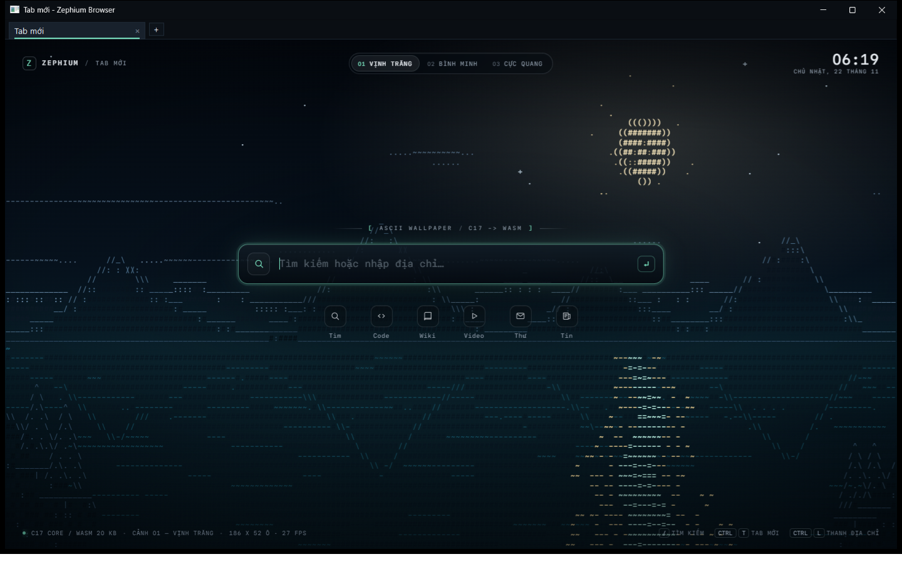

# Zephium · new tab

A full-bleed start page for Zephium's Windows WebView2 shell: an animated ASCII
landscape behind a centred omnibox, six shortcuts, a clock and a three-scene
switch.



## The core is C

All wallpaper pixels are produced by `ascii_core.c` (C17, freestanding), compiled
to WebAssembly by `build.ps1`. JavaScript only:

1. asks the core for a frame (`ascii_render`),
2. reads the returned `uint16_t` cells, and
3. paints each run of equal-coloured characters on a canvas.

There is no noise/terrain/water code in JavaScript. The native demo links the
same `.c` file:

```powershell
powershell -ExecutionPolicy Bypass -File build.ps1
.\ascii_demo.exe 0 160 48 3.0     # scene 0 = moonlit bay
.\ascii_demo.exe 1 160 48 3.0     # scene 1 = alpine dawn
.\ascii_demo.exe 2 160 48 3.0     # scene 2 = aurora
```

Requirements: a clang with the `wasm32` target, Node (for the base64 fallback),
and gcc (for the demo). No npm packages.

## Files

| File | What it is |
|---|---|
| `index.html` | Page structure, inline SVG icon sprite |
| `newtab.css` | Glass omnibox, scene palettes, responsive layout |
| `newtab.js` | Wasm loader, canvas painter, clock, suggestions, scene switch |
| `ascii_core.c` / `.h` | C17 wallpaper core: three hand-drawn scenes |
| `ascii_demo.c` | Native terminal preview of the same core |
| `build.ps1` | Builds `ascii_core.wasm`, `ascii_core_embed.js`, `ascii_demo.exe` |
| `embed.mjs` | Generates the base64 fallback used when `fetch` is blocked (`file://`) |
| `ascii_core.wasm` | Built core (about 20 KB, no imports) |
| `fonts/paper-mono.woff2` | Paper Mono from the ascii.rest kit (OFL; licence beside it) |
| `preview.png` | Screenshot of the start page in the running browser |
| `preview-browsing.png` | Same dark chrome while a real site (YouTube) is open |

## Cell format

`ascii_render(float time, int scene, int cols, int rows, float aspect)` fills a
static buffer of `uint16_t`:

```
bits 0..7   ASCII glyph
bits 8..15  palette slot (the page owns the actual colour)
```

`ascii_cells()` returns the pointer; the page builds a `Uint16Array` view over
WebAssembly memory. The buffer is fixed at 320 x 140 cells, so no allocator is
needed and the module imports nothing.

## Scenes

* **Vịnh trăng** — moon, layered peaks, a broken path of light on the water,
  stars, drifting cloud bands, low rock/pine silhouettes in the corners.
* **Bình minh** — sun behind stippled alpine ridges, snow, birds, a warm lake.
* **Cực quang** — three aurora curtains, a small moon, dark peaks and a lake
  that reflects the curtains.

Peaks are authored (position / height / slope) rather than sampled from noise;
small fBm noise keeps the ridge line from looking ruler-straight.

## Run it alone

```powershell
python -m http.server 8765 --directory .
# http://127.0.0.1:8765/index.html
# http://127.0.0.1:8765/index.html?scene=2   (1..3, for previews)
```

`?scene=N` is a preview override; the saved scene and the time of day decide the
normal default.

## How the shell uses it

`windows/zephium_win.cpp`:

* maps the virtual host `newtab.zephium` to this folder with
  `ICoreWebView2_3::SetVirtualHostNameToFolderMapping`;
* opens `https://newtab.zephium/index.html` for a new tab (and at startup when no
  URL is given);
* draws the title bar, tab strip, toolbar and URL field in the same dark ink for
  every tab, with a mint accent under the active tab (owner-drawn buttons,
  `WM_CTLCOLOR*` and DWM dark caption);
* hides the Win32 URL row on the start page, so the page is full-bleed;
* receives `navigate|<input>` messages from the page and resolves them through
  the C17 `navigation` core (`zephium_browser_navigate`), then navigates the
  originating tab.

The page also works as a normal web page: without `chrome.webview` it falls back
to `location.href`.

## Performance

At 1440x900 the grid is about 185 x 52 cells (around 9,600 cells). The C core
renders a frame in well under a millisecond; drawing is throttled to 30 fps and
pauses when the document is hidden or `prefers-reduced-motion` is set.
