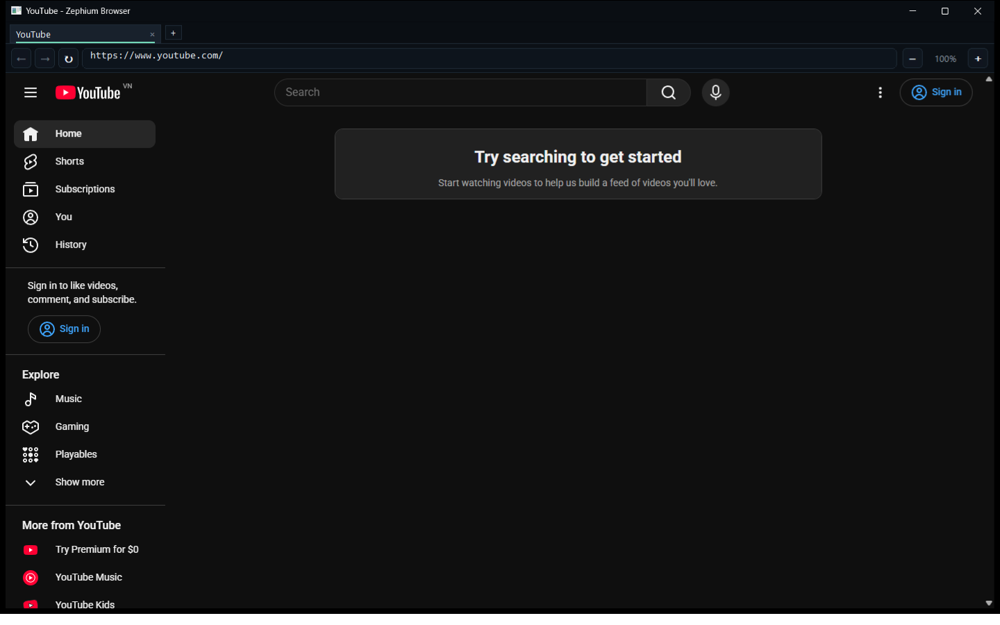

# Zephium for Windows (Win32 + WebView2)

WebKitGTK only exists on Linux, so the native Windows build embeds **WebView2**
(the Edge/Chromium engine that ships with Windows) instead, and reuses the same
portable C17 core (`zoom`, `navigation`, `store`, `browser_core`).



Chrome mặc định dùng chung một bộ màu tối: title bar (DWM), tab strip, toolbar, ô địa
chỉ và các nút điều hướng — kể cả khi tab đang mở một trang sáng. Nút tròn ngay trái
cụm zoom bật/tắt giao diện **Frutiger Aero** (gradient xanh, tab pill, nút tròn); lựa
chọn được lưu trong `%LOCALAPPDATA%\Zephium\theme.txt` và áp dụng cho cả start page.

```
windows/
├── zephium_win.cpp       # Win32 window + toolbar + WebView2 host (C++17)
├── adblock_webview2.h    # ad-block helpers shared with the console self test
├── adblock_webview2.cpp  # engine lifecycle, WinHTTP filter-list refresh, cache
├── adblock_selftest.cpp  # console self test (no WebView2/COM): decisions, cache,
│                         # thread affinity, panic containment, benchmark
├── Makefile              # mingw32-make build (builds blocker/rust too)
├── fetch_sdk.ps1         # downloads the WebView2 SDK into windows/sdk
├── fetch_rust.ps1        # installs rustup + the GNU Rust toolchain (idempotent)
├── sdk/                  # WebView2 SDK (not committed, fetched by the script)
├── zephium_win.exe       # build output
├── zephium_win_newtab.exe # prebuilt with the start page (release convenience)
├── newtab/               # start page assets copied by "mingw32-make assets"
└── WebView2Loader.dll    # build output (copied from the SDK)

../blocker/rust/          # adblock-rust C ABI shim (staticlib, see blocker/rust/README.md)
../newtab/                # start page source: C17 -> wasm wallpaper, HTML/CSS/JS, fonts
```

## Yêu cầu

- Windows 10/11 x64, đã có **Microsoft Edge WebView2 Runtime**
  (Windows 11 có sẵn; Windows 10 cài từ https://developer.microsoft.com/microsoft-edge/webview2/).
  Kiểm tra: `reg query "HKLM\\SOFTWARE\\WOW6432Node\\Microsoft\\EdgeUpdate\\Clients\\{F3017226-FE2A-4295-8BDF-00C3A9A7E4C5}"`
- MinGW-w64 (`gcc`, `g++`, `mingw32-make`) và SQLite3 (header + thư viện tĩnh), đều
  nằm trong search path mặc định của toolchain. Nếu chúng ở prefix riêng, khai báo trong
  `Makefile.local` ở thư mục gốc repo (file này không được commit) hoặc truyền biến cho make:

  ```powershell
  mingw32-make SQLITE_CFLAGS="-IC:\deps\sqlite\include" `
               SQLITE_LIBS="C:\deps\sqlite\lib\libsqlite3.a"
  ```

  Cùng cách đó để trỏ tới toolchain khác: `mingw32-make GCC="D:\x\gcc.exe" GXX="D:\x\g++.exe"`.

- **Rust toolchain cho ad blocking**: `rustup` + toolchain `stable-x86_64-pc-windows-gnu`
  (Rust >= 1.85, target GNU để link được với MinGW). Cài tự động bằng
  `fetch_rust.ps1`; lần build Rust đầu tiên cần mạng để tải crate từ crates.io.
  Nếu `cargo` không nằm trên `PATH`, Makefile tự dùng
  `%USERPROFILE%\.cargo\bin\cargo.exe`.

## Build

```powershell
cd C:\path\to\zephium-c\windows
powershell -ExecutionPolicy Bypass -File fetch_sdk.ps1    # chỉ lần đầu (WebView2 SDK)
powershell -ExecutionPolicy Bypass -File fetch_rust.ps1   # chỉ lần đầu (Rust + GNU toolchain)
mingw32-make
```

`mingw32-make` builds, in order: the portable C17 modules, the Rust static
library `blocker/rust/target/release/libzephium_adblock.a` (cargo; a one-time
~1-2 min build, reused afterwards), the shell objects and finally
`zephium_win.exe`. Kết quả: `zephium_win.exe` + `WebView2Loader.dll` trong `windows/`,
và `windows/newtab/` (start page HTML/CSS/JS/wasm/font) được copy từ `../newtab` bởi
target `assets` (chạy trong `all`; gọi riêng bằng `mingw32-make assets`).

Self test của ad blocking (console, không cần cửa sổ/WebView2, tự tải danh sách
thật nếu có mạng):

```powershell
mingw32-make adblock-test        # build + run windows\adblock_selftest.exe
mingw32-make clean               # xoá build output (giữ blocker/rust/target)
```

## Chạy

```powershell
.\zephium_win.exe                       # mở tab mới (ASCII start page)
.\zephium_win.exe https://grokipedia.com
```

Nếu đang mở một bản Zephium cũ thì Windows khoá file exe: đóng cửa sổ đó rồi build
lại, hoặc chạy bản build sẵn `zephium_win_newtab.exe` (cùng tính năng). Phím tắt:
`Enter` trong ô địa chỉ để điều hướng, `Esc` trả focus về trang.

## Tính năng

- **Multi-tab**: thanh tab tự vẽ (GDI) với nút `×` từng tab và nút `+`; tab đang mở
  có nền sáng, tab đang ngủ đông có tiền tố `⏾`. Mỗi tab sở hữu một
  `ICoreWebView2Controller` riêng trên cùng HWND.
- **Tab ngủ đông (hibernation)**: tab không active quá `--tab-sleep` phút sẽ bị huỷ
  webview (giữ URL/tiêu đề/zoom), khi bấm lại sẽ được tạo lại và nạp lại URL cũ.
  Không bao giờ ngủ tab đang active và tab đang phát audio
  (`ICoreWebView2_8::get_IsDocumentPlayingAudio`).
- **Start page full-bleed**: `Ctrl+T` hoặc khởi động không URL mở
  `https://newtab.zephium/index.html` (WebView2 virtual host trỏ vào `windows/newtab`).
  Hình nền ASCII sinh bởi core C17 → WebAssembly (20 KB), omnibox ở giữa màn hình,
  3 cảnh (Vịnh trăng / Bình minh / Cực quang), shortcut, đồng hồ và dòng trạng thái
  FPS. Khi trang này active, hàng toolbar Win32 được ẩn để nội dung full-bleed;
  omnibox gửi `navigate|<input>` về shell để core `navigation` phân loại URL/search.
- **Chrome tối đồng bộ**: title bar tối qua DWM, tab strip + toolbar tự vẽ, nút
  back/forward/reload/zoom owner-draw, ô địa chỉ borderless nền tối, tab active có
  gạch accent mint. Toolbar và tab strip giữ tông này cho mọi trang (kể cả trang sáng
  và start page), không quay về giao diện Win32 sáng.
- **Frutiger Aero (tuỳ chọn)**: nút tròn `ID_THEME` (1008) ngay trái nút zoom-out.
  Một click đổi palette, vẽ gradient xanh cho tab strip/toolbar, tab pill và nút
  ellipse, đổi caption/border DWM, ghi `theme.txt` rồi đẩy theme vào mọi tab đang mở
  start page. Mặc định vẫn là dark; file thiếu/rỗng/lạ hoặc `LOCALAPPDATA` không có
  đều quay về dark.
- Toolbar: back / forward / reload, ô địa chỉ, zoom -/+ (zoom theo từng tab), tiêu đề
  cửa sổ theo trang.
- Đồng bộ URL + trạng thái back/forward mỗi 400 ms (không cần COM event handler).
- Lịch sử duyệt web ghi vào SQLite (`zephium_profile.db`) qua core C17 dùng chung,
  URL được phân loại bởi module `navigation` (search fallback, SSRF guard) — kể cả
  khi điều hướng bằng link trong trang.
- **Ad blocking native** (adblock-rust, chặn ở tầng network qua
  `WebResourceRequested` — không dùng browser extension). Xem mục
  [Ad blocking](#ad-blocking-native-network-filtering) bên dưới.
- Autoplay được bật (`--autoplay-policy=no-user-gesture-required`).
- Log chẩn đoán: `windows/zephium_win.log`.

### Theme (dark / Frutiger Aero)

- **Mặc định**: dark, đúng geometry và màu của bản cũ. **Frutiger Aero** là tuỳ chọn:
  tab strip/toolbar dùng `GradientFill`, tab là pill `RoundRect`, các nút là
  `Ellipse`, caption và border DWM lấy theo `bg` của palette.
- **Nút chuyển**: owner-draw `ID_THEME` (1008) nằm ngay trái nút zoom-out; mặt nút là
  một ellipse nhỏ nên không phụ thuộc font symbol. Nút thuộc bộ control của toolbar
  nên cũng ẩn khi start page full-bleed.
- **Lưu**: `%LOCALAPPDATA%\Zephium\theme.txt`, UTF-8 không BOM, một dòng `dark` hoặc
  `aero` (newline cuối dòng được bỏ qua). File thiếu/rỗng/nội dung lạ/đọc lỗi →
  dark. Ghi lỗi → giữ theme trong phiên, log lỗi và **không** đụng file cũ (ghi qua
  file tạm rồi `MoveFileEx` thay thế). Không có `LOCALAPPDATA` → không lưu.
- **Start page**: sau mỗi lần click và mỗi `NavigationCompleted` của host
  newtab (kể cả URL có `?`/`#`), shell gọi
  `window.zephiumSetTheme("aero"|"dark")` bằng `ExecuteScript`. Hàm này chỉ đặt
  `body.dataset.theme` và pause/resume vòng vẽ ASCII; không điều hướng và không gửi
  message về shell. Lỗi `ExecuteScript` được log và lần navigation sau thử lại.

### Tuỳ chọn dòng lệnh

```
zephium_win.exe [URL] [--tab-sleep <phút>] [--tab-sleep-seconds <giây>] [--no-adblock]
```

- `--tab-sleep <phút>`: thời gian nhàn rỗi trước khi tab ngủ đông (mặc định **10** phút,
  `0` = tắt).
- `--tab-sleep-seconds <giây>`: như trên nhưng theo giây (dùng để test).
- `--no-adblock` hoặc `ZEPHIUM_ADBLOCK=0`: tắt bộ lọc quảng cáo cho phiên chạy này.

### Phím tắt

| Phím | Hành động |
|---|---|
| `Ctrl+T` | Tab mới |
| `Ctrl+W` | Đóng tab hiện tại |
| `Ctrl+Tab` / `Ctrl+Shift+Tab` | Tab kế / tab trước |
| `Ctrl+L` | Focus ô địa chỉ (trên start page: focus omnibox của trang) |
| `F5` | Tải lại |
| `Ctrl++` / `Ctrl+-` | Zoom tab hiện tại |

### Đo hiệu quả ngủ đông (4 tab nhẹ: example.com/org/net + Wikipedia)

| Cấu hình | Process | Private working set |
|---|---|---|
| Tắt ngủ đông | 9 | **196.3 MB** |
| Ngủ đông sau 8s | 6 | **119.3 MB** |

→ tiết kiệm ~39% RAM cho 4 tab nhẹ; với tab nặng (grokipedia, video) phần renderer
được giải phóng ngay, còn bộ nhớ GPU của WebGL có thể được Chromium thu hồi chậm hơn.

Lưu ý: tab ngủ đông khi đánh thức sẽ **nạp lại trang** (mất vị trí cuộn và trạng thái
form); đây là đánh đổi giống "sleeping tabs" của Edge/Chrome.

## Ad blocking (native network filtering)

The Windows shell filters **network requests**, not page content: every request
WebView2 is about to send is checked against Brave's
[adblock-rust](https://github.com/brave/adblock-rust) engine, which is linked into
`zephium_win.exe` as a static library through the frozen C ABI in
`blocker/adblock_ffi.h`. The browser-extension based approach this replaced
(`windows/extensions/`, `ICoreWebView2EnvironmentOptions6::AreBrowserExtensionsEnabled`,
`ICoreWebView2Profile7::AddBrowserExtension`) has been **removed**: no extension is
loaded, no content script runs, and page JavaScript cannot see or bypass the filter.

Ad blocking is an optimisation, never a correctness requirement: no engine, a failed
download or a caught Rust panic all degrade to "the request is allowed", so browsing
keeps working.

### How it works

1. When a tab's controller completes, the shell calls
   `AddWebResourceRequestedFilter(L"*", COREWEBVIEW2_WEB_RESOURCE_CONTEXT_ALL)` and
   registers `add_WebResourceRequested` with **one handler object per tab** (it only
   stores the tab id, so it can use that tab's document/iframe state). Handlers are
   owned by the webview; nothing is leaked on tab close or hibernation.
2. The handler reads the URI, method, resource context and `Referer` header, maps the
   WebView2 context to `ZEPHIUM_ADBLOCK_RES_*`, computes the source URL and calls
   `zephium_adblock_check()`.
   - Document requests use their own URL as source; subresources use `Referer`, then
     the tab's current document URL (tracked on `NavigationStarting` /
     `SourceChanged`).
   - Iframe navigations need care, see the limitations.
3. Verdicts:
   - **BLOCK** -> synthetic `204 No Content` response (Chromium sends no network
     traffic).
   - **REDIRECT** -> `200 OK` with the decoded `$redirect` body, `Content-Type`
     from the engine, plus `Access-Control-Allow-Origin: *` for scripts/stylesheets.
     These are built with `ICoreWebView2Environment::CreateWebResourceResponse` and an
     `IStream` from `SHCreateMemStream`.
   - **REWRITE** (`$removeparam`) -> counted and logged, request allowed (limitation
     below).
   - **ALLOW**, a check failure or any exception -> the event args are left untouched,
     so the request is sent unchanged.
4. Engine lifecycle - **all on the WebView2 UI thread**, because adblock-rust is built
   single-threaded and every handle is thread affine:
   - startup: warm load `engine.bin` (~ms when the lists are unchanged) -> else build
     from `lists\*.txt` (~100-400 ms) and write the cache -> else start a background
     download and rebuild from the `WM_APP` message when it finishes.
   - daily refresh: a worker thread (WinHTTP, no extra dependency) re-downloads the
     lists, compares FNV-1a content hashes, writes each file atomically (tmp+rename)
     and posts a message. The UI thread rebuilds the engine and swaps it; a failed
     build or download keeps the previous engine.
5. `lists\manifest.txt` records bytes+FNV-1a per list and the last refresh time. It
   validates the binary cache (stale cache -> rebuild) and drives the 24h refresh;
   the browser never downloads lists on the UI thread.

### Files and data locations

```
%LOCALAPPDATA%\Zephium\adblock\        # created on first run
├── engine.bin                         # compiled engine cache (~7 MB for ~150k rules)
└── lists\
    ├── manifest.txt                   # bytes + FNV-1a per list, last refresh time
    ├── easylist.txt                   # one raw ABP/uBO text list per file
    └── ...
```

- `%LOCALAPPDATA%` is used because the exe directory may be read-only (Program
  Files) while the lists and the ~7 MB cache must be writable. `ZEPHIUM_ADBLOCK_DIR=<dir>`
  overrides the whole tree (the self test uses it so tests never touch the
  production directory).
- If `%LOCALAPPDATA%\Zephium\adblock` exists but is not writable (locked-down profile,
  a process whose write access is restricted to its workspace), the shell probes it with
  a temporary file, falls back to `<exe dir>\zephium_adblock`, and logs both paths plus
  the Win32 error code; only when neither is writable does ad blocking run without lists
  (an existing engine cache can still be loaded). Failed list writes log the path and the
  Win32 error as well, and a refresh that could not store anything backs off 30 minutes
  instead of re-downloading on the next due-check.
- `--no-adblock` or `ZEPHIUM_ADBLOCK=0` disables the feature exactly as before (same
  log line, no lists touched). `ZEPHIUM_ADBLOCK=0` is read from the environment,
  `--no-adblock` from the command line.
- `blocker/rust/target/` is git-ignored; the downloaded lists and cache never enter
  the repository.

### Default filter lists

The engine reads raw ABP/uBO **text** lists (`list_texts` in the C ABI), never the
WebKit JSON used by the Linux shell. Default set (downloaded on first run, in the
background):

| id | source | default |
|---|---|---|
| `easylist` | https://easylist.to/easylist/easylist.txt | yes |
| `easyprivacy` | https://easylist.to/easylist/easyprivacy.txt | yes |
| `ublock-filters` | https://ublockorigin.github.io/uAssets/filters/filters.txt | yes |
| `ublock-badware` | https://ublockorigin.github.io/uAssets/filters/badware.txt | yes |
| `ublock-quick-fixes` | https://ublockorigin.github.io/uAssets/filters/quick-fixes.txt | yes |
| `ublock-privacy` | https://ublockorigin.github.io/uAssets/filters/privacy.txt | optional |
| `ublock-unbreak` | https://ublockorigin.github.io/uAssets/filters/unbreak.txt | optional |
| `peter-lowe` | https://pgl.yoyo.org/adservers/serverlist.php?hostformat=adblockplus&mimetype=plaintext | optional |

Per-list download cap is 2-8 MB (catalog table in `adblock_webview2.cpp`), total
on-disk lists are capped at 32 MB. A list that fails to download keeps the previous
file and is retried on the next daily check.

### Self test

```powershell
mingw32-make adblock-test                        # builds and runs windows\adblock_selftest.exe
.\windows\adblock_selftest.exe --no-network      # synthetic rules only
```

`adblock_selftest.exe` is a plain console program (no WebView2 runtime, no COM
window). It verifies the shared classification helpers (context -> type, main frame
vs iframe, source URL fallback), block/allow/redirect/rewrite decisions against a
synthetic list, the binary cache roundtrip and load timing, thread-affinity rejection
(a check from `std::thread` must return `ZEPHIUM_ADBLOCK_ERR_THREAD`), panic
containment (`zephium_adblock_engine_selftest_panic` poisons a handle, the next check
must return ALLOW without crashing) and the real shell lifecycle (build from list
files -> manifest/cache -> warm start). Then it builds an engine with ~140k synthetic
rules plus the real EasyList/EasyPrivacy/uBO filters (when the network is available)
and runs 100,000 checks, asserting p99 < 100 us/check. It returns non-zero if any
assertion fails and prints a PASS/FAIL summary.

Measured on the test machine (Windows 11, MinGW-w64 g++ 16.2, WebView2 157):

- engine with 140,000 synthetic rules + EasyList/EasyPrivacy/uBO filters:
  **280,516 rules** from 9,310 KB of lists, build **~200-380 ms**, cache **12.2 MB**
- 100,000 checks: **avg ~3.5-6.4 us**, median ~2.9-5.2 us, **p99 7.7-25 us**
  across runs on a loaded machine (asserted bound: 100 us; the max can spike to
  several ms when the first check for a new host compiles regexes)
- the Rust crate's own harness measured all 8 catalog lists
  (4,937,321 bytes -> 153,705 rules, cold build ~119 ms, 6.8 MB cache, warm load
  ~8 ms, avg 3.07 us / p99 11.3 us per check)

### Verifying ad blocking from zephium_win.log

Run the shell, browse, then look at `windows\zephium_win.log`:

```
ad blocking: enabled (native network filtering, adblock-rust)
adblock: zephium-adblock-ffi 1.0.0 (adblock-rust 0.13) (ABI 1), data dir C:\Users\...\AppData\Local\Zephium\adblock
adblock: 5 list(s) in the default set, cache C:\...\Zephium\adblock\engine.bin
adblock: warm start from engine.bin: 153705 rules, 4937321 bytes of filter lists, ABI 1
adblock: engine.bin loaded in 8 ms
adblock: request filtering installed for tab id=1
adblock: blocked script request in tab 1: https://doubleclick.net/...
adblock: served script placeholder (text/javascript, 21 bytes) in tab 1 for https://...
adblock: $removeparam rewrite (not supported by WebView2) for xhr in tab 1: ...
adblock stats: checks=... blocked=... redirected=... rewritten=... panics=0 avg=... ns
adblock final stats: checks=... blocked=... redirected=... rewritten=... panics=0 avg=... ns
```

- Only the first 20 blocked / redirected / rewritten requests per run are logged in
  full (URLs are redacted: query string and fragment removed); everything else is
  counted in the stats line, which is emitted at most every 10 s and only when the
  counters changed. The final stats line is written on exit.
- A run disabled with `--no-adblock` / `ZEPHIUM_ADBLOCK=0` logs
  `ad blocking: disabled (--no-adblock / ZEPHIUM_ADBLOCK=0)` and no `adblock:` lines.
- On first run the log says `adblock: downloading N filter list(s) in the
  background`; the first page may load unfiltered until that download and the
  UI-thread rebuild have finished.

### Limitations (verified vs not)

- **WebSockets are not filtered.** WebView2 never raises `WebResourceRequested` for
  WebSocket handshakes, so the engine's `ZEPHIUM_ADBLOCK_RES_WEBSOCKET` mapping is
  unused in practice. The alternative would be the DevTools Protocol
  (`Network.setBlockedURLs` per webview), which is URL-pattern based (no filter-list
  semantics, no redirect rules) and is **not implemented** here.
- **`$removeparam` (REWRITE) is not applied.** WebView2 cannot replace a request URL
  from `WebResourceRequested`; the shell counts and logs the rewrite and lets the
  request through. A CDP `Fetch` interception could, but it was not implemented.
- **Main frame vs iframe.** WebView2 reports iframe navigations as
  `COREWEBVIEW2_WEB_RESOURCE_CONTEXT_DOCUMENT` too. The shell tracks iframe
  navigation URLs from `ICoreWebView2_4::add_FrameCreated` +
  `ICoreWebView2Frame2::add_NavigationStarting` and relabels those requests as
  `SUBDOCUMENT`. The tracker is bounded (64 URLs, FIFO) and cleared on a new
  top-level document; an iframe whose navigation is not tracked is filtered with
  document rules instead of subdocument rules (possible under/over-blocking, never a
  crash). Without `ICoreWebView2_4`/`ICoreWebView2Frame2` (Runtime 1.0.1082+, i.e.
  every current install) the log says so and iframe documents are filtered as
  documents.
- **Synthetic responses.** Blocked requests get an empty 204 and redirects a local
  200 with the engine's decoded placeholder body. That is what makes blocking
  network-free, but a site that inspects response metadata may behave differently
  from a real 404/redirect. Redirect resources are limited to the placeholders the
  Rust crate can synthesize (`noop.js`, transparent gif/png, empty html, ...).
- **No cosmetic filtering (element hiding).** The C ABI exposes cosmetic CSS, but the
  Windows shell does not inject it into pages; only network rules are applied.
- **Thread affinity.** The engine is created/used/freed only on the WebView2 UI
  thread; the refresh thread never touches it. Checks are serialised on the UI
  thread, which keeps per-request cost in the microseconds.
- **Not verified end-to-end in the GUI here**: the shell was built and the console
  self test runs the same engine/manager code paths, but a real browsing session
  (cookies/CSP/redirect interop) was not exercised on a desktop session by this
  change; the log lines above are the way to verify it.

## Giới hạn (MVP)

- Một cửa sổ (nhiều tab trong cửa sổ đó); chưa có session restore sau khi tắt app.
- Ad blocking đã native (tầng network); chưa có download manager, chưa có element
  hiding/cosmetic filtering và chưa lọc được WebSocket — xem mục
  [Ad blocking](#ad-blocking-native-network-filtering).
- `zephium_win.cpp` dùng C++17 vì WebView2 là COM/C++; phần core vẫn là C17 thuần.

## Bộ nhớ (RAM)

Số đo trên máy test (Windows 11 26300, WebView2 157.0.4341.60). Cột "MB" là
**private working set** — đúng đại lượng Task Manager hiển thị ở cột Memory, cộng cho
toàn bộ process của app:

| Trang | Cửa sổ | Tổng | Ghi chú |
|---|---|---|---|
| example.com (tĩnh) | 1280x800 | **~94 MB** | ngang với bản Rust (~91 MB) |
| YouTube watch (video đang phát) | 1280x800 | **~620 MB** | renderer ~295 + GPU ~260 |
| YouTube watch (video đang phát) | 720x480 | **~460 MB** | giảm theo diện tích video |

Kết luận: phần "nặng" là **giải mã video + frame buffer của GPU process**, không phải
shell. Cùng một engine thì chi phí mỗi trang là như nhau; khác biệt lớn nhất đến từ
kích thước video đang hiển thị và trang đó có đang phát hay không.

Bản Rust (Tauri/wry) trong Task Manager hiện 2 nhóm: nhóm "WebView2: Zephium" ~91 MB là
**cửa sổ chrome UI** (5 process, không có renderer của trang), còn nhóm có tab YouTube
(~382 MB, renderer + GPU) mới là trang thật — nên so sánh phải cùng loại nhóm.

Cờ tiết kiệm RAM đang dùng (học từ bản Rust):

- `--disable-features=msWebOOUI,msPdfOOUI,SpareRendererForSitePerProcess,
  msEdgeSidebarV2,msEdgeAutofill,msEdgeDiscover,msEdgeShoppingAssistant,
  msEdgeWebCapture,msEdgeCollections`
  → không có spare renderer dự phòng (~40 MB), không nạp service Office/PDF/Sidebar/Discover.
- `--disable-background-networking --disable-component-update`
  → không tải component/telemetry chạy nền.
- `--autoplay-policy=no-user-gesture-required`: giữ để YouTube tự phát; nếu ưu tiên RAM
  thì bỏ cờ này (đo được ~611 MB → ~546 MB cho một trang video).

Muốn giảm RAM khi xem video: thu nhỏ cửa sổ (623 → 463 MB) và tránh mở nhiều tab video
cùng lúc.

## Ghi chú kỹ thuật

- `ICoreWebView2EnvironmentOptions` được tự cài đặt vì helper của SDK cần WRL
  (`<wrl/implements.h>`) mà MinGW không có.
- `TargetCompatibleBrowserVersion` **phải** là chuỗi version hợp lệ, nếu để rỗng
  thì `CreateCoreWebView2EnvironmentWithOptions` trả `E_INVALIDARG` (0x80070057).
  Giá trị đang dùng khớp với `CORE_WEBVIEW_TARGET_PRODUCT_VERSION` của SDK 1.0.4370.26.
- Response tổng hợp (204/200 + body) đi qua `ICoreWebView2Environment::CreateWebResourceResponse`
  với `IStream` từ `SHCreateMemStream` (`-lshlwapi`).
- Link với Rust staticlib cần thêm `-lsynchronization` (futex của Rust std dùng
  `WaitOnAddress`/`WakeByAddress*` không nằm trong import lib kernel32 của MinGW) cùng
  `-lws2_32 -luserenv -lntdll`; xem `LIBS` trong `Makefile`.
- Start page được phục vụ qua `ICoreWebView2_3::SetVirtualHostNameToFolderMapping`
  (`https://newtab.zephium/` → `windows/newtab`), nên `fetch('ascii_core.wasm')` chạy
  như HTTP bình thường và trang không cần `file://`. Cầu `navigate|` chỉ nhận message
  từ trang có `Source` bắt đầu bằng `https://newtab.zephium/`; trang ngoài không thể
  điều khiển shell qua bridge.
- Chrome: mọi màu đi qua `ChromePalette` + `Chrome()` (hai instance `kDarkPalette`,
  `kAeroPalette`). `WM_DRAWITEM` vẽ nút, `WM_CTLCOLOREDIT/STATIC` trả brush được tạo
  lại khi đổi theme, `DwmSetWindowAttribute` (attr 20 cho Win11, 19 cho Win10 20H1+,
  35/34 cho caption và border) lấy `bg` của palette. Bản Aero dùng `GradientFill`
  (`-lmsimg32`). Khi toolbar ẩn, `ContentRect()` bắt đầu ngay dưới tab strip để start
  page full-bleed.
- Theme → start page: `NavigationCompleted` (đăng ký trên mọi `ICoreWebView2`) gọi
  `SendThemeToView()` nếu `IsNewTabUrl(Source)`; `PushThemeToNewTabViews()` làm việc
  tương tự ngay sau click cho các tab đang mở. Script chỉ chạy trên view có URL
  `newtab.zephium`, và `theme.txt` nằm ngoài profile SQLite.
- Request của start page cũng đi qua ad blocker (cùng `WebResourceRequested`); các
  asset nội bộ này không khớp rule nào nên luôn được cho qua, và engine chưa sẵn sàng
  thì mọi request fail-open như bình thường.